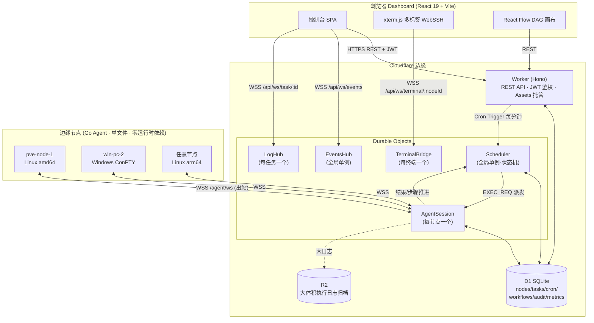
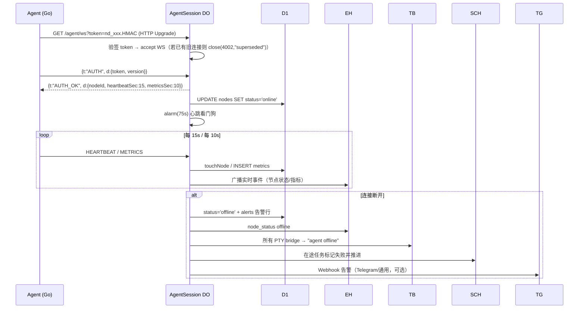
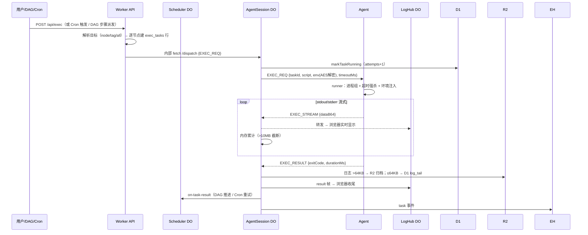
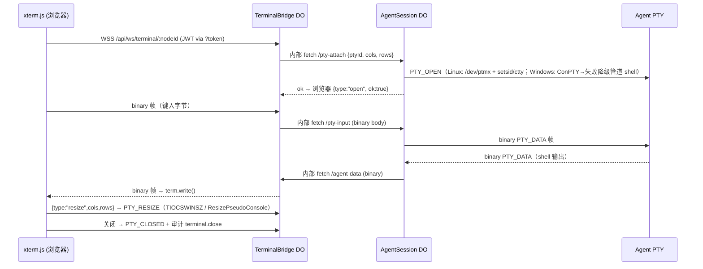
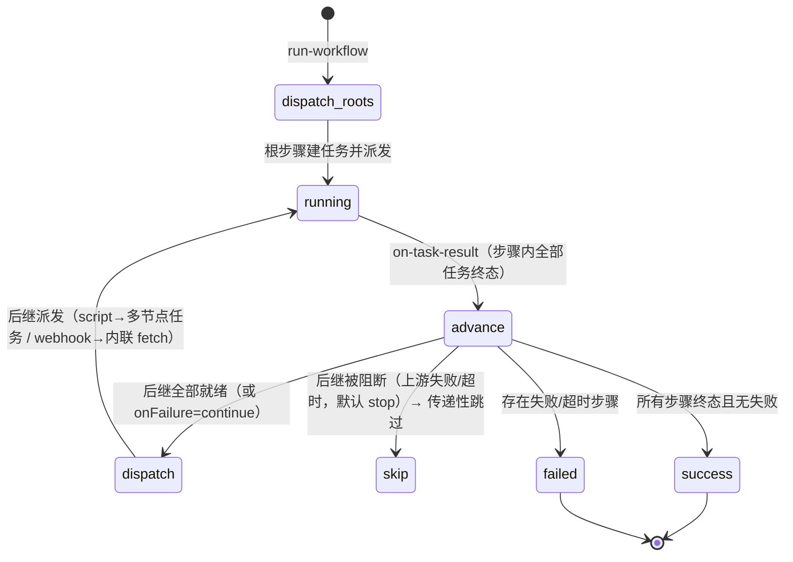
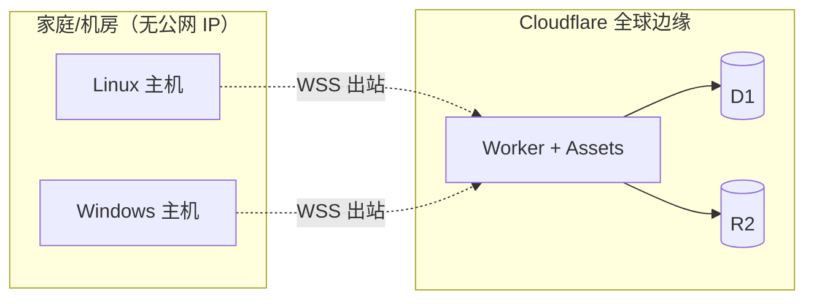

# OmniMesh 架构

## 1. 系统全景



**核心设计原则**

1. **Agent 主动出站**：边缘节点永不监听端口，全部通过 WSS 反向连接控制平面，穿透 NAT/防火墙。
2. **DO 即路由表**：每个节点的 `AgentSession` DO 持有该 agent 的长连接，任何下行动作（EXEC_REQ / PTY_OPEN / FILE_TRANSFER_REQ）都是对相应 DO 的一次内部 fetch，毫秒级直达。
3. **无状态 Worker + 有状态 DO**：REST 层无状态可水平扩展；会话/编排状态收敛在 DO 内保证强一致。
4. **单一事实来源**：Agent ⇄ 平面、平面 ⇄ 浏览器的全部消息类型由 `packages/shared/src/index.ts` 定义，Go/TS 双端各自实现同一契约并有互验测试。

## 2. Agent ⇄ 控制平面协议

### 2.1 传输模型

- **控制消息**：WS **text** 帧，JSON 信封 `{ "t": "<TYPE>", "ts": <ms>, "d": {…} }`
- **流式数据**：WS **binary** 帧（绕过 JSON 解析，PTY 毫秒级延迟）：

```
┌──────────┬──────────┬────────────────────┬──────────────────────────┐
│ kind (1B)│ idLen(1B)│ channelId (0-255B) │ payload (PTY 字节/文件块) │
└──────────┴──────────┴────────────────────┴──────────────────────────┘
  0x01 = PTY 数据            0x02 = 文件传输块
```

### 2.2 连接生命周期



### 2.3 任务执行



失败重试：Cron 任务失败/超时且 `attempts ≤ retries` 时，Scheduler 以 30s 递增的 `retry_at` 重新排队；离线派发同样进入该队列。

### 2.4 WebSSH（浏览器 ⇄ PTY）



断线自愈：agent 断开时向所有 bridge 广播 `agent offline`；agent 重连成功后 AgentSession 自动对每个存活 bridge 重新发送 `PTY_OPEN`，终端无需用户干预即可恢复。

### 2.5 文件传输（FILE_TRANSFER）

- **上传**（平面→节点）：`FILE_TRANSFER_REQ{direction:"upload", size}` 后跟 binary `0x02` 块；agent 收满 `size` 字节落盘并回 `FILE_TRANSFER_ACK{done}`。
- **下载**（节点→平面）：agent 收到 `direction:"download"` 后流式发送块并最终回 `ACK{done}`；平面聚合后经 REST 返回给浏览器（≤6MB）。全程写审计日志。

## 3. 调度引擎

### 3.1 Scheduler DO（全局单例）

- **alarm 循环**：每 15s `tick()`（Workers Cron 触发器每分钟也调用 `/tick`，两者幂等）。
- **Cron 触发**：5 段表达式（UTC）由纯函数解析器计算 `next_run`；到期即对匹配目标（node/tag/all 在线节点）逐个建任务并派发，Vixie 语义（dom/dow 皆受限时 OR）。
- **重试队列**：`status='queued' AND retry_at<=now` 的任务重新派发。
- **保留策略**：每小时清理 8 天前的 metrics 明细（1h/24h/7d 查询按 30s/5m/1h 分桶聚合）。

### 3.2 DAG 状态机



- 图校验（Kahn 环检测、目标合法性、重复 id）在创建/更新时与每次派发前执行。
- 推进逻辑为**纯函数** `advance()`（`src/dag.ts`），配 11 个单元测试覆盖：根派发、汇合等待、失败阻断、continue 分支、传递性跳过、成功收敛。

## 4. 数据模型（D1）

| 表 | 用途 |
|---|---|
| `users` | 控制台账号（PBKDF2） |
| `nodes` | 节点注册表（labels JSON、status、last_seen） |
| `reg_keys` | 注册密钥（SHA-256 哈希 + prefix 展示） |
| `metrics` | 指标明细（PK node_id+ts，8 天保留） |
| `cron_jobs` | 定时任务（expr、target、env_enc、next_run） |
| `exec_tasks` | 任务全生命周期（含 retry_of/retry_at/log_path） |
| `workflow_defs` / `workflow_runs` / `run_steps` | DAG 定义 / 运行快照 / 步骤状态机 |
| `audit_logs` | 全操作审计（登录/派发/终端/配置变更） |
| `alerts` | 告警记录（Webhook 推送标记） |
| `settings` | KV 配置（Webhook 配置，secrets 加密） |
| `terminal_sessions` | WebSSH 会话开闭时间审计 |

## 5. Agent 内部结构（纯 Go 标准库）

```
cmd/omni-agent          入口：flags → config → client.Run；service install/uninstall/--service-run
internal/config         JSON 配置文件 + OMNI_* 环境变量 + flag 三级合并，原子保存
internal/protocol       信封/载荷结构 + 二进制帧编解码（与 TS 共享契约，互验测试）
internal/wsframe        RFC6455 客户端：握手(Sec-WebSocket-Accept 校验)、掩码流式写、
                        自动 ping→pong、close 处理、TLS(wss) 与 InsecureSkipVerify
internal/backoff        指数退避 + full jitter（1s→60s），成功即重置
internal/metrics        Linux: /proc/stat|meminfo|net|diskstats|loadavg + statfs
                        Windows: GlobalMemoryStatusEx / GetSystemTimes / GetIfTable /
                        GetDiskFreeSpaceExW（纯 syscall，IF_OPERATIONAL=5）
internal/runner         shell/python 执行器：32KB 流式块、超时强杀（进程组/taskkill /T）、
                        环境注入、取消
internal/pty            Linux: /dev/ptmx(TIOCGPTN/TIOCSPTLCK/TIOCSWINSZ/TIOCSCTTY)
                        Windows: ConPTY(CreatePseudoConsole+属性列表) + 2.5s 探针
                        → 静默自动降级管道会话（兼容 24H2+ 0xC0000142 回归）
internal/service        Linux: systemd 单元写入 + enable --now；信号转停机
                        Windows: advapi32 SCM(CreateService/StartServiceCtrlDispatcher)
internal/client         会话编排：注册→AUTH→读写泵→心跳/指标→任务/PTY/文件分发→断线自愈
```

## 6. 前端结构（React 19）

- **Shell**：可折叠侧栏 + 移动端抽屉 + 全局实时事件（EventsHub）+ Toast。
- **页面**：Overview（聚合仪表 + 15 分钟集群 CPU 多线曲线）、Nodes/NodeDetail（1h/24h/7d 四联图）、Terminal（多标签、字号缩放、断线提示）、Workflows（列表/编辑器/运行视图三页，React Flow 双向绑定步骤状态色）、CronJobs（预览下次执行、启停、立即运行、历史）、AuditLogs（动作分类 + 搜索 + 分页）、Settings（密钥签发/吊销、Telegram/通用 Webhook、文件传输、改密）。
- **实时层**：`useEvents()` 维护到 EventsHub 的常驻 WS（自动重连）；任务日志经 LogHub WS 流式 append；xterm 二进制直通。

## 7. 部署拓扑



生产部署只需 Cloudflare 免费套餐即可承载个人规模（D1 免费额度 5GB、DO 请求数按量、Cron 每分钟触发）。
